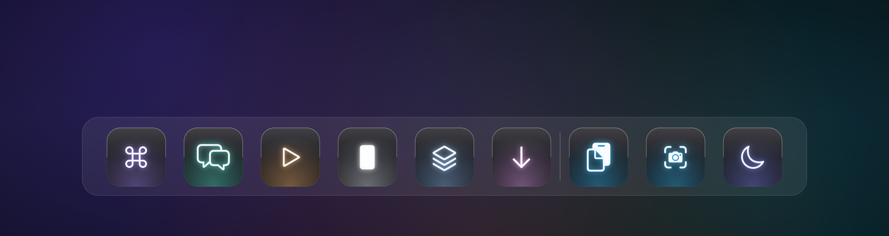

<p align="center">
  
</p>

<h1 align="center">Glow Dock</h1>

<p align="center">
  A dark, glow-glass macOS Dock, installed from one file.
</p>

<p align="center">
  <a href="https://github.com/SamayW/glow-dock/releases/latest"><b>Download</b></a>&nbsp;&nbsp;·&nbsp;&nbsp;macOS 13 or later&nbsp;&nbsp;·&nbsp;&nbsp;Apple silicon and Intel
</p>

---

Glow Dock rebuilds your Dock as one matching set. Every app and folder becomes a dark glass tile with a single soft glow. Your apps are grouped into stacks that open as grids, and the set comes with a midnight wallpaper to match. Everything is drawn on your Mac, at your Mac's resolution, from SF Symbols and the apps' own logos.

## Install

1. Download **Glow-Dock-1.0.0.zip** from [Releases](https://github.com/SamayW/glow-dock/releases/latest) and unzip it.
2. Double-click **Install Glow Dock.command**.
   If macOS says it can't verify the developer, run it from Terminal instead:
   ```sh
   zsh ~/Downloads/"Install Glow Dock.command"
   ```
3. The installer ends with two one-time steps:
   - **App Management**: to restyle Brave and VS Code, allow Terminal in *System Settings → Privacy & Security → App Management*, then run `~/Library/Dock Stacks/Reapply Dock Theme.command`.
   - **Shortcuts**: click **Add Shortcut** for each of the three Devices shortcuts.

> [!IMPORTANT]
> Glow Dock **replaces your Dock's layout**. The app section is set to Brave, Claude and VS Code (any you have), followed by the stacks below. Your current Dock is backed up first; see [Undo](#undo).

## What you get

| | |
|---|---|
| **Apps** | Brave, Claude and VS Code as glass tiles, with the glyph lifted from each app's real logo |
| **Work** | Terminal, Docker, Chrome, Notes, Calendar, Reminders, Freeform, System Settings |
| **Social** | WhatsApp, Messages, Mail, FaceTime, Contacts |
| **Media** | Photos, Spotify, Music, TV, Podcasts, Preview, Photo Booth |
| **Devices** | iPhone Mirroring, Phone, AirDrop, Find My, Passwords, Home, Shortcuts, plus three shortcuts: *AirDrop Clipboard*, *AirDrop Screenshot* and *Focus Everywhere* |
| **Projects** | One tile per project; clicking it opens the project in VS Code |
| **Downloads** | Every sub-folder gets its own glyph and colour |
| **Wallpaper** | *Midnight Glow*, rendered at your display's native resolution |
| **Dock** | 56 pt icons, magnification on, no recent apps, always visible |

Apps you don't have are skipped, and running the installer again is safe.

## Undo

The installer saves your previous Dock to `~/Library/Dock Stacks/.theme/` before changing anything. To go back:

```sh
defaults import com.apple.dock ~/Library/Dock\ Stacks/.theme/dock-backup-<date>.plist
killall Dock
```

After that, delete `~/Library/Dock Stacks` and pick a new wallpaper in System Settings.

## Keeping it looking right

When an app updates, it puts its own icon back. Run this to restyle everything again:

```sh
~/Library/Dock Stacks/Reapply Dock Theme.command
```

## Make it yours

The release installs a generic Projects stack. To fill it with your own projects, build the installer yourself. This needs the Xcode Command Line Tools.

```sh
git clone https://github.com/SamayW/glow-dock.git && cd glow-dock
cp projects.example.conf projects.conf       # Name|path|SF Symbol|glow colour
cp downloads.example.conf downloads.conf     # optional: extra Downloads folders
./build.sh                                   # → dist/Install Glow Dock.command
```

`projects.conf` and `downloads.conf` are gitignored, so your paths stay on your Mac.

## How it's built

| Path | |
|---|---|
| `src/dockglow.swift` | Draws the glass tiles, the wallpaper and the preview above (built as a universal binary) |
| `src/installer-head.zsh` | Installer settings; the project lists are filled in at build time |
| `src/installer-body.zsh` | The steps: stacks, shortcuts, icons, wallpaper, Dock |
| `shortcuts/` | The three Shortcuts, stored unsigned and signed during the build |
| `build.sh` | Assembles everything into one self-contained `.command` |

To regenerate `docs/preview.png`, run `swiftc -O src/dockglow.swift -o dockglow && ./dockglow preview docs/preview.png`.

---

<p align="center">Designed and developed by <a href="https://github.com/SamayW">Samay Wadhwani</a> · © 2026 · All rights reserved</p>
